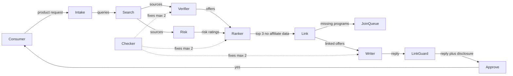
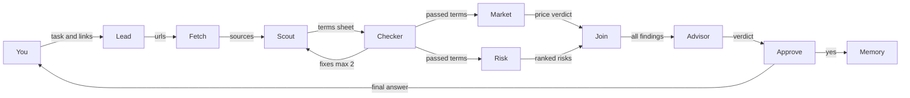

# Teams

Agent definitions live in `teams/*.json`. Each agent has JOB, INPUT, OUTPUT,
DONE WELL (3 to 5 checks), NEVER and ASK ME FIRST, which the runner turns into
its prompt. Stages starting with `@` are code steps, not LLM calls.

## Deal finder (first job)

| Node | Job | Hands to |
|---|---|---|
| Intake | Request to brief: product, budget, country, must-haves, QUERY lines | search |
| @search | Code: run queries via MCP/SearXNG, read top pages | Verifier, Risk |
| Verifier | Real offers with exact URL, total cost, stock, returns | Ranker |
| Risk | Seller and offer risk, quoted from sources | Ranker |
| Ranker | Top 3 on value only, GOOD DEAL yes/no; never sees affiliate data | @link |
| @link | Code: add affiliate links you have, queue merchants without one | Writer |
| Writer | Consumer reply, links copied exactly | your approval |
| Checker | Scores each agent against DONE WELL, max 2 fix rounds | back to agent |

Paste this code at mermaid.live to see the picture.

Plain version: Consumer -> Intake -> search -> (Verifier || Risk) -> Ranker -> link -> Writer -> link guard -> disclosure -> your approval -> Consumer. Every agent's output goes through the Checker first.

## Deal researcher (vet one deal you already have)

| Agent | Job | Hands to |
|---|---|---|
| Scout | Extract exact terms and true total cost from the sources | Market, Risk |
| Market | Compare the price against alternatives in the sources | Advisor |
| Risk | Find hidden fees, lock-in, refund limits, seller issues | Advisor |
| Advisor | First line BUY / NEGOTIATE / WALK, 3 reasons, total cost, top risk | You |
| Checker | Scores every output against that agent's DONE WELL | back to agent, max 2 rounds |

Lead routing rules (first match wins):
- task contains "quick" or "fast": Scout, then Advisor
- task contains "scam", "legit" or "red flag": Scout, then Risk, then Advisor
- otherwise: Scout, then Market and Risk in parallel, then Advisor

Paste this code at mermaid.live to see the picture.

Plain version: You -> Lead -> Fetch -> Scout -> Checker -> (Market || Risk) -> Join -> Advisor -> Checker -> your approval -> answer + memory.
(Market, Risk and Advisor each also go through the Checker; failures go back with exact fixes, at most 2 rounds, then reach you flagged.)

## Dev company (v2, drafted)

Product (spec) -> Architect (design) -> Engineer (code) || QA (tests from the
spec, not the code) -> approval -> files written to `workspace/<run>/`.
Run with `--team dev_company`. Not yet tested on the local model.

## Loops

- **Quality:** the Checker returns pass/fail per check and exact fixes; the
  agent revises; at most 2 rounds, then the work reaches you with what is
  still wrong.
- **Improvement:** weekly, `improve` finds the agent with the lowest
  first-try pass rate and proposes ONE change. Nothing changes until you run
  `--apply`.
